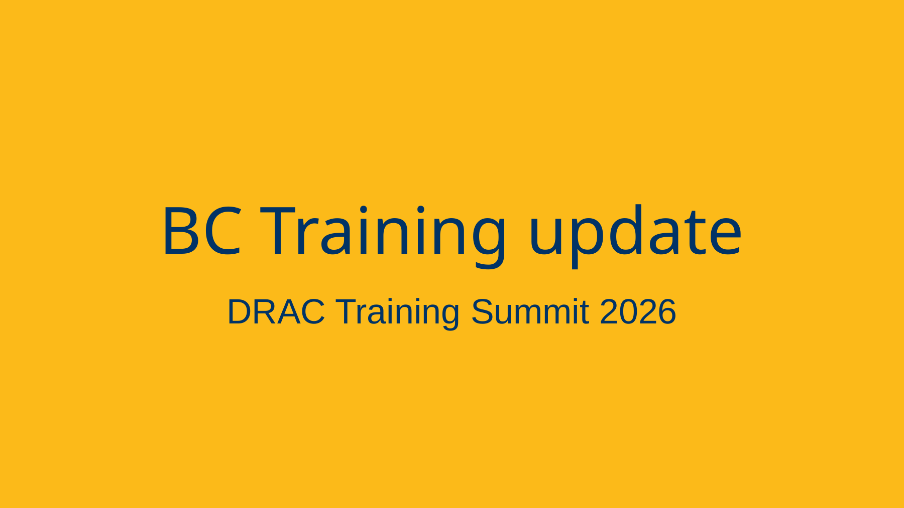

*Presented at the National Training Summit in Calgary, AB, in November 2026.*

:::{.def}

A brief summary of the advanced research computing training offered in BC since the last national training summit.

For the SFU RCG team (our team), 3,322 learner hours were delivered across 83 sessions and 182 hours. 23 new topics were developed including several new courses focused on GPUs. Finally, 86 materials were added to [the Explora Canadian DRI training discovery platform](https://explora.alliancecan.ca/).

:::

[{.img-fluid .rounded-0}](2026_training_summit_bc_update.pdf){target="_blank"}
