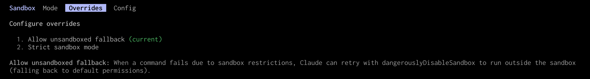

## {.center}

*The landscape is evolving fast*

*This webinar is about communicating concepts*

*Tools are only shown as examples and which tools you choose depends on your OS, how important your data and your system are, and your personal risk tolerance*

## The problem {.center}

Cybersecurity is not new. What changed?

:::{.fragment}

:::{.emph}

AI agents

:::

:::

::::{.columns}

:::{.column width="49%"}

:::{.fragment}

**Outside risk**

➔ Finding exploits for cyberattacks has become a lot easier for a lot more actors

:::

:::

:::{.column width="2%"}
:::

:::{.column width="49%"}

:::{.fragment}

**Inside risk**

➔ New risks coming from *inside* your own system from your own agents

:::

:::

::::

## Multiagent orchestration {.center}

Multiple agents run in parallel in child threads

Demultiplies token usage and risks if poorly managed

## AI agents {.center}

:::{.emph}

AI agent = model + harness

:::

```{dot}
//| echo: false

graph G {
    // Use the neato layout engine for manual coordinate positioning
    layout=neato;

    // The outer circle
    Harness [
        shape=circle,
        width=3.5,       // Size of the outer circle
        height=3.5,
        fixedsize=true,
        pos="0,0!",      // Pinned to the center coordinate
        labelloc="t",    // Place the label at the top inside the node
        label="Harness",
        fontsize=18,
        penwidth=2
    ];

    // The inner "dot"
    Model [
        shape=circle,
        width=1,         // Smaller size for the inner dot
        height=1,
        fixedsize=true,
        pos="0,0!",      // Pinned to the exact same center coordinate
        style=filled,
        fillcolor=black,
        fontcolor=white,
        label="Model",
        fontsize=14
    ];
}
```

## Model {.center}

LLM \
The *intelligent* part \
Passive text generator

Not a liability in itself \
(beside hallucinations and disinformation)

## Harness {.center}

Software infrastructure that turns the model into an **actor**

- Set of tools to run code, read files, search the web...
- Context & memory fed to the model
- Guardrails & safety layers (unfortunately flawed)

These function in a **loop** until a goal is reached:

Reason ➔ Act ➔ Check result ➔ Reason ➔ Act ➔ ... ➔ Goal

## Examples CLI harnesses {.center}

[OpenCode](https://github.com/anomalyco/opencode) (open source) \
[Codex CLI](https://github.com/openai/codex) (OpenAI, open source for Codex CLI only) \
[Claude Code](https://github.com/anthropics/claude-code) (Anthropics, fully closed source) \
[Antigravity CLI](https://github.com/google-antigravity/antigravity-cli) (Google, fully closed source) \
[GitHub Copilot CLI](https://github.com/github/copilot-cli) (GitHub, fully closed source) \
...

## What are the risks? {.center}

Data loss \
Compromised system \
Privacy breaches \
Exposition of sensitive data

# 1. Update often

## Update {.center}

Agents keep finding vulnerabilities

Install patches as soon as they are released \
(rolling distros might be at an advantage)

**Make sure to update/install from trusted sources**

# 2. Backup often

## Backup {.center}

*Examples of backup tools:*

[BorgBackup](https://github.com/borgbackup/borg) (Python) \
[restic](https://github.com/restic/restic) (Go) and its Rust implementation [rustic](https://github.com/rustic-rs/rustic) \
[Vykar](https://github.com/borgbase/vykar) (Rust) \
[Kopia](https://github.com/kopia/kopia) (Go)

**Make sure that backups are encrypted if they are online**

# 3. Use version control

## Version control {.center}

For all your projects

Consider using it for your system files

It will make undoing actions of agents A LOT easier

# 4. Use a password manager

## Password manager {.center}

*Example of open-source tool:* [KeePassXC](https://github.com/keepassxreboot/keepassxc)

- Never reuse passwords
- Be mindful of your clipboard and tools using it

::::{.columns}

:::{.column width="54%"}

<br>
Randomly generated multi-word passphrases provide more entropy than short passwords while being easier to remember

:::

:::{.column width="2%"}
:::

:::{.column width="44%"}


:::

::::

# 5. Be mindful of sensitive data

## What is where? {.center}

What sensitive data do you have where?

:::{.note}

Check your computer(s), phone, old/broken computers/phones, backup systems, files remote systems, online files (e.g. Google Drive, emails)

:::

Does it need to be there?

**Delete sensitive data where not needed**

## Who has access to what? {.center}

Who has access to your sensitive data?

Do they need to have access?

**Remove access to shared online documents when not needed anymore \
On shared systems, remove access from users who don't need it**

## Linux file permissions {.center}

Learn the [Linux permission system](https://docs.alliancecan.ca/wiki/Sharing_data/en)

➔ `chown` and `chmod` commands

For more subtle sharing, check [access control lists (ACLs)](https://docs.alliancecan.ca/wiki/Sharing_data/en#Access_control_lists_(ACLs))

## Encryption {.center}

::::{.columns}

:::{.column width="49%"}

### At the hardware level

Not using RAM nor CPUs \
More secure and more efficient

Hardware Security Module (HSM) \
Self-Encrypting Drive (SED)

:::

:::{.column width="2%"}
:::

:::{.column width="49%"}

### Using software

Files encryption \
Directories encryption

File system encryption \
Whole disk encryption

:::

::::

## Encryption {.center}

::::{.columns}

:::{.column width="49%"}

### At the hardware level

Not using RAM nor CPUs \
More secure and more efficient

Hardware Security Module (HSM) \
Self-Encrypting Drive (SED)

:::

:::{.column width="2%"}
:::

:::{.column width="49%"}

### Using software

**Files encryption** \
**Directories encryption**

File system encryption \
Whole disk encryption

:::

::::

## Files encryption: OpenPGP {.center}

[Open standard for cryptographic operations](https://en.wikipedia.org/wiki/OpenPGP) \
Cross platform \
Uses key pairs: public key to encrypt and private key to decrypt

Evolving with new algorithms and post-quantum cryptography \
New format: [RFC 9580](https://www.rfc-editor.org/info/rfc9980/) using [Ed25519](https://ed25519.cr.yp.to/) elliptic curve algorithm

It is not the default in common applications \
**Make sure to use RFC 9580 when generating keys**

## Sequoia PGP {.center}

OpenPGP is used by [GnuPG](https://en.wikipedia.org/wiki/GNU_Privacy_Guard), although now diverging from it

A more modern and robust Rust implementation is [Sequoia PGP](https://sequoia-pgp.org/)

[Installation instructions](https://book.sequoia-pgp.org/installation.html)

Generate key pair:

```{.bash}
sq key generate --profile rfc9580 --own-key --name "John Doe" --email jdoe@example.com
```

List certificates and keys:

```{.bash}
sq cert list
```

## Sequoia PGP {.center}

Encrypt files:

```{.bash}
sq encrypt --binary --for <keyid> <file> --signer-email <email> --output <file>.gpg
```

Decrypt:

```{.bash}
sq decrypt <file>.gpg --output <file>
```

## Sequoia GnuPG Chameleon {.center}

Sequoia Chameleon is a reimplementation of the GnuPG interface so that existing software (email clients, scripts, etc.) can use Sequoia without code modifications

`gpg-sq` & `gpgv-sq` emulate `gpg` & `gpgv`

You can symlink `gpg-sq` to `gpg` to act as drop-in replacement:

```{.bash}
mkdir $HOME/bin
ln -s /usr/bin/gpg-sq $HOME/bin/gpg
export PATH="$HOME/bin:$PATH"
```

```{.bash}
gpg --version
which gpg
```

## Directories encryption: gocryptfs {.center}

[Installation instructions](https://nuetzlich.net/gocryptfs/compile/)

[Details on cryptography](https://nuetzlich.net/gocryptfs/forward_mode_crypto/)

## gocryptfs {.center}

### Initialization

```{.bash}
# Create data dir (cipher) and mount dir (plain)
mkdir cipher plain
```

```{.bash}
# Create master key (stored in gocryptfs.conf)
# and directory initialization vector (stored in gocryptfs.diriv)
gocryptfs -init cipher
# ls cipher
```

## gocryptfs {.center}

### Usage

```{.bash}
# Mount cipher onto plain
gocryptfs cipher plain
```

```{.bash}
# Create test files and dirs
touch plain/file{01..10}
mkdir plain/dir{1..5}
# ls plain
# ls cipher
```

```{.bash}
# Unmount plain
fusermount3 -u plain
# ls plain
```

## gocryptfs {.center}

To use the KeePassXC password manager to automatically use a pwd to mount, you could do:

```{.bash}
keepassxc-cli show -a password <database>.kdbx <password> | gocryptfs cipher plain
```

# 6. Sandbox your agents

## What is a sandbox? {.center}

A form of containment

Does not prevent unexpected behaviours but \
**reduces the blast radius**

There are [many tools](https://gist.github.com/wincent/2752d8d97727577050c043e4ff9e386e)

## Trade-off {.center}

```{dot}
//| echo: false

digraph G {
    bgcolor="transparent"
    
    // Horizontal layout
    rankdir=LR;
    
    // Controls the vertical spacing between the words and the arrow
    nodesep=0.01;
    
    // 1. Style the words (Smaller font, no borders)
    node [shape=plaintext, fontname="Helvetica, Arial, sans-serif", fontsize=11];
    
    // Define the word nodes with their new colors
    Conv [label=<<b>Convenience</b>>, fontcolor="#e67e22"]; // Red
    Sec [label=<<b>Security</b>>, fontcolor="#3973ac"];     // Green
    
    // 2. Create tiny, invisible nodes for the arrow endpoints
    node [shape=none, label="", width=0, height=0];
    p_Conv;
    p_Sec;
    
    // 3. Force the words to sit perfectly aligned above their respective arrow endpoints
    { rank=same; Conv -> p_Conv [style=invis]; }
    { rank=same; Sec -> p_Sec [style=invis]; }
    
    // 4. Draw the colored, double-headed arrow connecting the points beneath the words
    p_Conv -> p_Sec [dir=both, penwidth=1.5, color=grey35, minlen=4];
}
```

## Levels of isolation {.center}

```{dot}
//| echo: false

digraph G {
    bgcolor="transparent"
    
    // Horizontal layout
    rankdir=LR;
    
    // Keeps the arrow perfectly straight
    splines=false;
    
    // REDUCED SPACING:
    // ranksep controls horizontal spacing. Lowering it packs the elements closer.
    ranksep=0.2;
    // nodesep controls vertical spacing between the words, arrow, and boxes.
    nodesep=0.2;
    
    // --- 1. Top Row: Concepts & Spacers ---
    node [shape=plaintext, fontname="Helvetica, Arial, sans-serif", fontsize=11];
    Conv [label=<<b>Convenience</b>>, fontcolor="#e67e22"];
    Sec  [label=<<b>Security</b>>, fontcolor="#3973ac"];
    
    // Invisible spacers for the top row (to push the technologies inward)
    node [shape=point, width=0, height=0, style=invis];
    t_OS; t_Cont; t_VM;
    
    // --- 2. Middle Row: Arrow Axis Points ---
    p_Start; p_OS; p_Cont; p_VM; p_End;
    
    // --- 3. Bottom Row: Technologies & Spacers ---
    // Colored boxes for technologies
    node [shape=box, style="rounded", penwidth=2, fontname="Helvetica, Arial, sans-serif", fontsize=11];
    OS   [label="OS-level",  color="#cc9900", fontcolor="#cc9900"]; // Orange
    Cont [label="Local microVM", color="#86b300", fontcolor="#86b300"]; // Purple
    VM   [label="Cloud options",        color="#008080", fontcolor="#008080"]; // Red
    
    // Bottom spacers for outer columns (to balance Convenience and Security)
    node [shape=point, width=0, height=0, style=invis];
    b_Conv; b_Sec;

    // --- Layout Grid Constraints ---

    // Build the 5 Vertical Columns (Forces perfect center alignments)
    // Col 1 (Far left): Convenience directly above the left arrow tip
    { rank=same; Conv -> p_Start -> b_Conv [style=invis]; }
    
    // Col 2, 3, 4 (Middle): Technologies tucked inside the arrow's length
    { rank=same; t_OS -> p_OS -> OS [style=invis]; }
    { rank=same; t_Cont -> p_Cont -> Cont [style=invis]; }
    { rank=same; t_VM -> p_VM -> VM [style=invis]; }
    
    // Col 5 (Far right): Security directly above the right arrow tip
    { rank=same; Sec -> p_End -> b_Sec [style=invis]; }

    // Build the 3 Horizontal Rows
    Conv -> t_OS -> t_Cont -> t_VM -> Sec [style=invis];
    p_Start -> p_OS -> p_Cont -> p_VM -> p_End [style=invis];
    b_Conv -> OS -> Cont -> VM -> b_Sec [style=invis];

    // --- Draw the Visible Arrow ---
    // Connects the far-left point to the far-right point.
    p_Start -> p_End [dir=both, penwidth=1.5, color="gray35", constraint=false];
}
```

## Options {.center}

```{dot}
//| echo: false

digraph G {
    bgcolor="transparent"
    
    // Horizontal layout
    rankdir=LR;
    
    // Keeps the arrow perfectly straight
    splines=false;
    
    // REDUCED SPACING:
    // ranksep controls horizontal spacing. Lowering it packs the elements closer.
    ranksep=0.01;
    // nodesep controls vertical spacing between the words, arrow, and boxes.
    nodesep=0.3;
    
    // --- 1. Top Row: Concepts & Spacers ---
    node [shape=plaintext, style="", fontname="Helvetica, Arial, sans-serif", fontsize=11];
    Conv [label=<<b>Convenience</b>>, fontcolor="#e67e22"];
    Sec  [label=<<b>Security</b>>, fontcolor="#3973ac"];
    
    // Invisible spacers for the top row (to push the technologies inward)
    node [shape=point, width=0, height=0, style=invis];
    t_OS; t_Cont; t_VM;
    
    // --- 2. Middle Row: Arrow Axis Points ---
    p_Start; p_OS; p_Cont; p_VM; p_End;
    
    // --- 3. Bottom Row: Technologies & Spacers ---
    // Colored boxes for technologies
    node [shape=box, style="rounded", penwidth=2, fontname="Helvetica, Arial, sans-serif", fontsize=15];
    OS   [label="OS-level",  color="#cc9900", fontcolor="#cc9900"]; // Orange
    Cont [label="Local microVM", color="#86b300", fontcolor="#86b300"]; // Green
    VM   [label="Cloud options", color="#008080", fontcolor="#008080"]; // Teal
    
    // Bottom spacers for outer columns (to balance Convenience and Security)
    node [shape=point, width=0, height=0, style=invis];
    b_Conv; b_Sec;

    // --- 4. Lists Row (New) ---
    // CRITICAL FIX: Added style="" to remove the "invis" style from the previous node declaration
    node [shape=plaintext, style="", fontname="Helvetica, Arial, sans-serif", fontsize=11, fontcolor="#333333"];
    
    L_OS [label=<
        <table border="0" cellborder="0" cellpadding="1">
            <tr><td align="left" href="https://github.com/containers/bubblewrap"><font color="#48bc7c">bubblewrap</font>&nbsp;&nbsp;(Linux)</td></tr>
            <tr><td align="left" href="https://en.wikipedia.org/wiki/Seccomp"><font color="#48bc7c">seccomp</font>&ensp;&nbsp;(Linux)</td></tr>
            <tr><td align="left">Landlock (Linux)</td></tr>
            <tr><td align="left">Seatbelt (macOS)</td></tr>
            <tr><td align="left">etc.</td></tr>
        </table>
    >];

    L_Cont [label=<
        <table border="0" cellborder="0" cellpadding="1">
            <tr><td align="left" href="https://github.com/superradcompany/microsandbox"><font color="#48bc7c">microsandbox</font></td></tr>
            <tr><td align="left" href="https://www.docker.com/products/docker-sandboxes"><font color="#48bc7c">Docker Sandboxes</font></td></tr>
            <tr><td align="left">etc.</td></tr>
            <tr><td align="left">&nbsp;</td></tr>
            <tr><td align="left">&nbsp;</td></tr>
        </table>
    >];

    L_VM [label=<
        <table border="0" cellborder="0" cellpadding="1">
            <tr><td align="left" href="https://github.com/e2b-dev/e2b">Cloud microVMs</td></tr>
            <tr><td align="left" href="https://github.com/firecracker-microvm/firecracker">➔ often based on <font color="#48bc7c">&ensp;&nbsp;Firecracker</font></td></tr>
            <tr><td align="left" href="https://github.com/e2b-dev/e2b">➔ e.g. <font color="#48bc7c">&nbsp;E2B</font></td></tr>
            <tr><td align="left" href="https://github.com/e2b-dev/e2b">Self-hosted microVMs (e.g. <font color="#48bc7c">&ensp;&nbsp;E2B</font>)</td></tr>
            <tr><td align="left"><font color="gray65">Spinning your own VM</font></td></tr>
            <tr><td align="left"><font color="gray65">➔ often based on QEMU</font></td></tr>
            <tr><td align="left"><font color="gray65">➔ slow and less safe</font></td></tr>
        </table>
    >];

    // List row spacers for the far-left and far-right columns
    node [shape=point, width=0, height=0, style=invis];
    l_Conv; l_Sec;

    // --- Layout Grid Constraints ---

    // Build the 5 Vertical Columns (Forces perfect center alignments)
    { rank=same; Conv -> p_Start -> b_Conv -> l_Conv [style=invis]; }
    { rank=same; t_OS -> p_OS -> OS -> L_OS [style=invis]; }
    { rank=same; t_Cont -> p_Cont -> Cont -> L_Cont [style=invis]; }
    { rank=same; t_VM -> p_VM -> VM -> L_VM [style=invis]; }
    { rank=same; Sec -> p_End -> b_Sec -> l_Sec [style=invis]; }

    // Build the 4 Horizontal Rows
    Conv -> t_OS -> t_Cont -> t_VM -> Sec [style=invis];
    p_Start -> p_OS -> p_Cont -> p_VM -> p_End [style=invis];
    b_Conv -> OS -> Cont -> VM -> b_Sec [style=invis];
    l_Conv -> L_OS -> L_Cont -> L_VM -> l_Sec [style=invis];

    // --- Draw the Visible Arrow ---
    // Connects the far-left point to the far-right point.
    p_Start -> p_End [dir=both, penwidth=1.5, color="gray35", constraint=false];
}
```

## What about containers? {.center}

Not designed for sandboxing purposes

**Kernel shared with the host (vulnerability)**

Most require root privilege which adds exposure. Apptainer (rootless) is better

**➔ Same level of inconvenience as microVM for less security**

## What about built-in tools? {.center}

Harnesses come with a number of modes, options, and capabilities \
**Familiarize yourself with the harness you use**

Models are changing so fast that any architecture around them becomes instantly obsolete

Companies rebuild their harness every couple of weeks

**This is a very fast evolving topic**

## Instructions & skills {.center}

::::{.columns}

:::{.column width="49%"}

### Persistent context

`CLAUDE.md`, `AGENTS.md`, `GEMINI.md`, etc. are files containing rules that agents read at the start of each session

***Unfortunately, you cannot trust agents to follow instructions***

:::

:::{.column width="5%"}
:::

:::{.column width="46%"}

### Skills

Modular and reusable files containing instruction for specific tasks

:::

::::

## Modes {.center}

```{dot}
//| echo: false

digraph G {
    bgcolor="transparent"
    
    // Horizontal layout
    rankdir=LR;
    
    // Keeps the arrow perfectly straight
    splines=false;
    
    // ranksep controls horizontal spacing. Lowering it packs the elements closer
    ranksep=0.2;
    // nodesep controls vertical spacing between the words, arrow, and boxes
    nodesep=0.2;
    
    // --- 1. Top Row: Concepts & Spacers ---
    node [shape=plaintext, fontname="Helvetica, Arial, sans-serif", fontsize=11];
    Conv [label=<<b>Convenience</b>>, fontcolor="#e67e22"];
    Sec  [label=<<b>Security</b>>, fontcolor="#3973ac"];
    
    // Invisible spacers for the top row (to push the modes inward)
    node [shape=point, width=0, height=0, style=invis];
    m_YOLO; m_Auto; m_Manual;
    
    // --- 2. Middle Row: Arrow Axis Points ---
    p_Start; p_YOLO; p_Auto; p_Manual; p_End;
    
    // --- 3. Bottom Row: Modes & Spacers ---
    // Reset style (inherited from the invisible spacers above) so the labels show
    node [shape=plaintext, fontname="Helvetica, Arial, sans-serif", fontsize=11, style=""];
    YOLO [label="YOLO",  fontcolor="#cc9900"];
    Auto [label="Auto-accept", fontcolor="#86b300"];
    Manual [label="Manual-accept", fontcolor="#008080"];
    
    // Bottom spacers for outer columns (to balance Convenience and Security)
    node [shape=point, width=0, height=0, style=invis];
    b_Conv; b_Sec;

    // --- Layout Grid Constraints ---

    // Build the 5 Vertical Columns (Forces perfect center alignments)
    // Col 1 (Far left): Convenience directly above the left arrow tip
    { rank=same; Conv -> p_Start -> b_Conv [style=invis]; }
    
    // Col 2, 3, 4 (Middle): Modes tucked inside the arrow's length
    { rank=same; m_YOLO -> p_YOLO -> YOLO [style=invis]; }
    { rank=same; m_Auto -> p_Auto -> Auto [style=invis]; }
    { rank=same; m_Manual -> p_Manual -> Manual [style=invis]; }
    
    // Col 5 (Far right): Security directly above the right arrow tip
    { rank=same; Sec -> p_End -> b_Sec [style=invis]; }

    // Build the 3 Horizontal Rows
    Conv -> m_YOLO -> m_Auto -> m_Manual -> Sec [style=invis];
    p_Start -> p_YOLO -> p_Auto -> p_Manual -> p_End [style=invis];
    b_Conv -> YOLO -> Auto -> Manual -> b_Sec [style=invis];

    // --- Draw the Visible Arrow ---
    // Connects the far-left point to the far-right point.
    p_Start -> p_End [dir=both, penwidth=1.5, color="gray35", constraint=false];
}
```

⚠️ *YOLO ("You Only Live Once") mode removes all guardrails*


## Command hooks {.center} 

Some harnesses allow to set hooks that run before certain commands

They can however be bypassed by agents using alternative utilities/methods/paths/etc.

## Built-in sandboxes {.center}

**Codex**

`on` by default

- Linux/WSL2: Landlock/seccomp or bubblewrap
- Windows (PowerShell): native Windows sandbox
- macOS: Apple's Seatbelt

**Claude Code**

`off` by default, controlled by agent (!!)

**Antigravity CLI**

Seatbelt on macOS, container on Windows, container with [gVisor](https://github.com/google/gvisor) on Linux

## Built-in sandboxes {.center}

If the sandbox is part of the harness, the agent might be able to control it (in the case of Claude Code, it absolutely can...)

```{dot}
//| echo: false

graph G {
    // Use the neato layout engine for manual coordinate positioning
    layout=neato;

    // 1. The outermost circle
    Harness [
        shape=circle,
        width=4.5,
        height=4.5,
        fixedsize=true,
        pos="0,0!",      // Pinned to center
        labelloc="t",    // Label at the top inside the node
        label="Harness",
        fontsize=18,
        penwidth=2
    ];

    // 2. The middle circle
    Sandbox [
        shape=circle,
        width=2.8,
        height=2.8,
        fixedsize=true,
        pos="0,0!",      // Pinned to exact same center
        labelloc="t",    // Label at the top inside this middle node
        label="Sandbox",
        fontsize=16,
        penwidth=2,
		fontcolor="#9d22b2"
		color="#9d22b2"
    ];

    // 3. The inner "dot"
    Model [
        shape=circle,
        width=1.2,
        height=1.2,
        fixedsize=true,
        pos="0,0!",      // Pinned to exact same center
        style=filled,
        fillcolor=black,
        fontcolor=white,
        label="Model",
        fontsize=14
    ];
}
```

## Built-in sandboxes {.center}

Not to mention some exceptionally ridiculous design decisions...



🤨 ... 🤣

## Adding your own sandbox {.center}

If you don't trust the agent, some constraints need to be *outside* the harness, out of reach of the agent

```{dot}
//| echo: false

//| echo: false

graph G {
    // Use the neato layout engine for manual coordinate positioning
    layout=neato;

    // 1. The outermost circle
    Sandbox [
        shape=circle,
        width=4.5,       // Increased size to fit the middle circle
        height=4.5,
        fixedsize=true,
        pos="0,0!",      // Pinned to center
        labelloc="t",    // Label at the top inside the node
        label="Sandbox",
        fontsize=18,
        penwidth=2,
		fontcolor="#9d22b2"
		color="#9d22b2"
    ];

    // 2. The middle circle
    Harness [
        shape=circle,
        width=2.8,       // Sized between the outer and inner circles
        height=2.8,
        fixedsize=true,
        pos="0,0!",      // Pinned to exact same center
        labelloc="t",    // Label at the top inside this middle node
        label="Harness",
        fontsize=16,
        penwidth=2
    ];

    // 3. The inner "dot"
    Model [
        shape=circle,
        width=1.2,       // Smallest size for the center dot
        height=1.2,
        fixedsize=true,
        pos="0,0!",      // Pinned to exact same center
        style=filled,
        fillcolor=black,
        fontcolor=white,
        label="Model",
        fontsize=14
    ];
}
```

## More complex systems {.center}

Everybody is experimenting

The sandbox outside the harness still contains the risks of API keys and sensitive data egress (data exfiltration)

There are more complex systems that isolate the agent and the data in separate microVMs

:::{.info}

There is no consensus yet on tools and practices

:::

## bubblewrap {.center}

[bubblewrap](https://github.com/containers/bubblewrap) is the engine behind [Flatpak](https://github.com/flatpak/flatpak) \
Linux only \
Installed on the clusters

You bind mount directories and set env variables needed \
Everything else is out of reach \
You end by launching a shell/tmux/your agent/your MCP servers

```{.bash}
bwrap \
    --ro-bind /usr/bin /usr/bin \
    --bind $HOME/.cache $HOME/.cache \
    --setenv HOME "$HOME" \
    --setenv USER "$USER" \
	<command>
```

## bubblewrap {.center}

*Example script:*

```{.bash}
#!/bin/bash

# Stop and exit quickly if something fails (easier to debug)
set -euo pipefail

# You could limit available commands here
SANDBOX_PATH="$HOME/.local/bin:/usr/local/bin:/usr/bin:/bin"

# use exec to replace current script by bwrap command instead of forking
# --ro-bind bind mounts paths read-only
# --bind bind mounts paths with write access
exec /usr/bin/bwrap \
    --tmpfs /tmp \
    --dev /dev \
    --dir /dev/shm \
    --tmpfs /dev/shm \
    --proc /proc \
    --hostname ptsbox --unshare-uts \
    --ro-bind /bin /bin \
    --ro-bind /lib /lib \
    --ro-bind /lib64 /lib64 \
    --ro-bind /usr/bin /usr/bin \
    --ro-bind /usr/lib /usr/lib \
    --ro-bind /usr/local/bin /usr/local/bin \
    --ro-bind /usr/local/lib /usr/local/lib \
    --ro-bind /etc/resolv.conf /etc/resolv.conf \
    --ro-bind /etc/profile.d /etc/profile.d \
    --ro-bind /etc/ssl/certs /etc/ssl/certs \
    --ro-bind /etc/passwd /etc/passwd \
    --ro-bind /etc/ld.so.cache /etc/ld.so.cache \
    --ro-bind /etc/ld.so.conf /etc/ld.so.conf \
    --ro-bind /etc/ld.so.conf.d /etc/ld.so.conf.d \
    --ro-bind /etc/localtime /etc/localtime \
    --ro-bind /usr/share/terminfo /usr/share/terminfo \
    --ro-bind /usr/share/ca-certificates /usr/share/ca-certificates \
    --ro-bind /etc/nsswitch.conf /etc/nsswitch.conf \
    --ro-bind /etc/hosts /etc/hosts \
    --ro-bind /etc/gai.conf /etc/gai.conf \
    --ro-bind /etc/ssl/openssl.cnf /etc/ssl/openssl.cnf \
    --ro-bind /usr/share/zoneinfo /usr/share/zoneinfo \
    --ro-bind $HOME/.bashrc $HOME/.bashrc \
    --ro-bind $HOME/.gitconfig $HOME/.gitconfig \
    --ro-bind $HOME/.local $HOME/.local \
    --ro-bind /etc/ca-certificates /etc/ca-certificates \
    --ro-bind "$XDG_RUNTIME_DIR/bus" "$XDG_RUNTIME_DIR/bus" \
    --bind $HOME/.cache $HOME/.cache \
    --bind "$PWD" "$PWD" \
    --setenv HOME "$HOME" \
    --setenv USER "$USER" \
    --setenv PATH "$SANDBOX_PATH" \
    --setenv XDG_RUNTIME_DIR "$XDG_RUNTIME_DIR" \
    --setenv DBUS_SESSION_BUS_ADDRESS "unix:path=$XDG_RUNTIME_DIR/bus" \
    --chdir "$PWD" \
    --setenv TERM "$TERM" \
    --setenv XDG_RUNTIME_DIR "$XDG_RUNTIME_DIR" \
    --setenv DBUS_SESSION_BUS_ADDRESS "unix:path=$XDG_RUNTIME_DIR/bus" \
    zsh
```

## bubblewrap {.center}

Now compare this from the launched Zsh vs a normal Zsh:

```{.bash}
cd /etc
ls
```

## microsandbox {.center}

### Installation

[microsandbox](https://github.com/superradcompany/microsandbox) is a cross-platform local microVM

[Installation instructions](https://docs.microsandbox.dev/getting-started/quickstart)

Test installation with:

```{.bash}
msb doctor
```

:::{.notenoit}

On Linux, make sure that you have KVM loaded

Example:

```{.bash}
sudo modprobe kvm_intel
```

:::

## microsandbox {.center}

Can run TypeScript, Rust, Python, Go, Ruby, or from the CLI

We'll use the CLI here

Uses OCI (Open Container Initiative) images from Docker Hub or other registry

## microsandbox {.center}

### Help

[CLI instructions](https://docs.microsandbox.dev/cli/overview)

::::{.columns}

:::{.column width="49%"}

```{.bash}
msb --help
```

:::

:::{.column width="2%"}
:::

:::{.column width="49%"}

```{.bash}
msb --tree
```

:::

::::

Subcommands:

::::{.columns}

:::{.column width="49%"}

```{.bash}
msb image --help
```

:::

:::{.column width="2%"}
:::

:::{.column width="49%"}

```{.bash}
msb image --tree
```

:::

::::

Navigate long help outputs with for instance:

```{.bash}
msb run --help | less
```

## microsandbox {.center}

### Examples

```{.bash}
msb run ubuntu -- echo hello
```

```{.bash}
msb run ubuntu -- bash
```

```{.bash}
msb ls
```

```{.bash}
msb run --name devbox ubuntu -- bash
# msb ls
```

## microsandbox {.center}

### Running agent (e.g. OpenCode)

```{.bash}
msb run -t --name opencodebox --replace \
  --cpus 2 --memory 2G --root-disk 4G \
  --mount-dir .:/workspace:rw \
  --workdir /workspace \
  node:24-bookworm-slim -- sh -lc '
    apt-get update &&
    apt-get install -y --no-install-recommends ca-certificates git &&
    npm install -g opencode-ai@1.18.4 &&
    exec opencode
  '
```

## Additional considerations {.center}

### MCP

Gives your agents new accesses and capabilities \
Review carefully \
Also needs to run inside your sandbox

### Log agent sessions

Might help you troubleshoot if things go wrong
